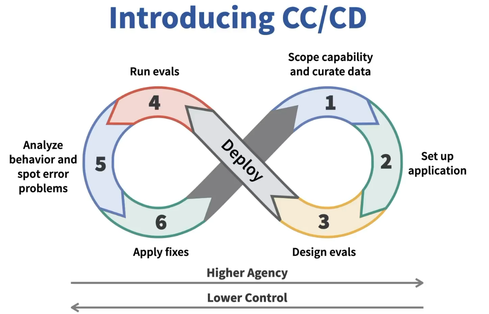

# Learning agentic AI

This repository is for learning basic agentic AI development through customer support. The practice is to start with a small automation, score it, and give the agent more of the work only when that score supports the change.

That loop is continuous calibration / continuous development (CC/CD). Calibration is the evaluation: labeled cases, a score, and a trace of what the model did. Development is the next edit, one change at a time. Building an agent with a high level of agency requires that continuous calibration and improvement. Each pass is an intentional increase in autonomy.

**Action autonomy** (`action_autonomy`) is the small start. It reads one customer message and chooses one department. A person takes the case. **Planning autonomy** (`planning_autonomy`) is the next step of agency. It keeps that routing step, retrieves procedures, and writes a plan a person can follow. The same kind of score decides whether that extra work helped.

Start with [docs/index.md](docs/index.md). It is the step-by-step path through this repo. The commands for both agents are in [runbook.md](runbook.md).
