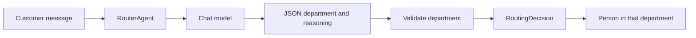

# The action agent

`RouterAgent` in `action_autonomy/agent.py` is the whole action agent. `route` takes one customer message and returns one `RoutingDecision`.

## What happens for one message

1. The selected system prompt and the customer message go to the chat model. Temperature is `0.1`. The response format is the JSON schema from the previous page.
2. The code reads the JSON object. It must contain `department` and `reasoning`.
3. `department_from_name` checks the name. A blank or unknown name becomes `ESCALATION`.
4. The method returns a `RoutingDecision`.

A failed request or a reply that is not JSON stops the run with `RuntimeError`. There is no guessed department in that case.

## The result

`RoutingDecision` holds three fields:

| Field | Meaning |
| --- | --- |
| `department` | A `Department` value |
| `reasoning` | The model's short explanation |
| `customer_message` | The message that was sent |

`Department` is the enum in `action_autonomy/models.py`. The name, such as `BILLING`, is what the model returns. The value, such as `billing`, is the lowercase form stored on the enum.

| Department | What belongs there |
| --- | --- |
| `BILLING` | Payments, charges, refunds, refund status, balances, fees |
| `RETURNS` | Return requests, exchanges, return status, return policies |
| `TECHNICAL_SUPPORT` | Login problems, password resets, website errors, checkout failures |
| `ORDER_STATUS` | Tracking, shipping updates, delivery questions, missing items |
| `PRODUCT_INQUIRY` | Product questions, specifications, availability, pricing |
| `ACCOUNT_MANAGEMENT` | Profile updates, saved payment methods, preferences, address changes |
| `ESCALATION` | Customers asking for a manager or supervisor |

The agent stops at the decision. It does not open a ticket or reply to the customer. A person in that department takes the case.

The system prompt is not fixed inside `RouterAgent`. The caller passes it. The next page is how those prompts differ.

Next: [Prompts](05-prompts.md)
