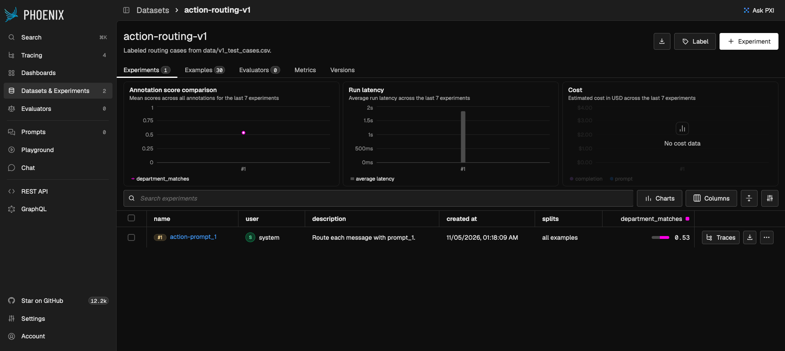

# Terminal and Phoenix

A score command prints the experiment name and a URL. The experiment holds the score for every row. A trace holds what was sent to the model and what came back.

`--message` and `--demo` have no label, so they stay on the terminal. They become an experiment only when you score the CSV.

Start Phoenix from [runbook.md](../runbook.md). Leave authentication off (`PHOENIX_ENABLE_AUTH=false`). These agents do not send an API key. With authentication on, Phoenix rejects the client and the traces.

A score command exits when port 6006 is closed. It does not fall back to a local report. `--message` and `--demo` still run without Phoenix. If you add `--trace` and Phoenix is down, those two print the Docker hint and then continue without traces.

## What each place shows

| | Terminal | Experiment | Trace, when you pass `--trace` |
| --- | --- | --- | --- |
| One message or the demo | The decision for that message | Nothing. There is no label | Input and output of the model call |
| One evaluation case | No per-row line | The task output and the evaluator label | Input and output of the model call |
| After every case | The experiment name and the compare URL | Every row's score on that page | The model calls for that project |

The experiments page shows the mean score for the run. Here `action-prompt_1` has `department_matches` at 0.53. The Evaluators count stays 0. The compare URL, below, is where each row shows `PASS` or `FAIL`.



The compare URL looks like this:

```text
http://127.0.0.1:6006/datasets/<dataset id>/compare?experimentId=<experiment id>
```

## The score and the trace

For an action experiment, open the compare URL. `department_matches` is `PASS` or `FAIL`. The task output on that row is the department and the reason.

Pass `--trace` on the same score command when you want the model call as well. The call is recorded in a tracing project. Open Traces, select the project, and open the call.

| What you see on the model call | Where it comes from |
| --- | --- |
| Input | The system prompt and the customer message |
| Output | The JSON the model returned: `department` and `reasoning` |
| Status | Ok when the model call succeeded |

That status is the request, not the score. A call can succeed and `department_matches` can still be `FAIL`. Token use and latency are on the call. The experiment row is where you read `PASS` or `FAIL`.

## Projects

Each prompt has its own tracing project, so two traced runs do not mix. The experiment names are separate from these projects. Both prompts of one agent share one dataset.

| Run | Tracing project | Experiment |
| --- | --- | --- |
| Action `prompt_1` | `V1_action_autonomy_prompt_1` | `action-prompt_1` on `action-routing-v1` |
| Action `prompt_2` | `V1_action_autonomy_prompt_2` | `action-prompt_2` on `action-routing-v1` |
| Planning `prompt_1` | `V2_planning_autonomy_prompt_1` | `planning-prompt_1` on `planning-v2` |
| Planning `prompt_2` | `V2_planning_autonomy_prompt_2` | `planning-prompt_2` on `planning-v2` |

A planning experiment stores `sop_recall` and `plan_alignment` on each row. The trace of a planning run is the router call, the plan call, and the judge call. The recall score and the `good`, `partial`, or `bad` label are the experiment.

Next: [The planning agent](09-the-planning-agent.md)
